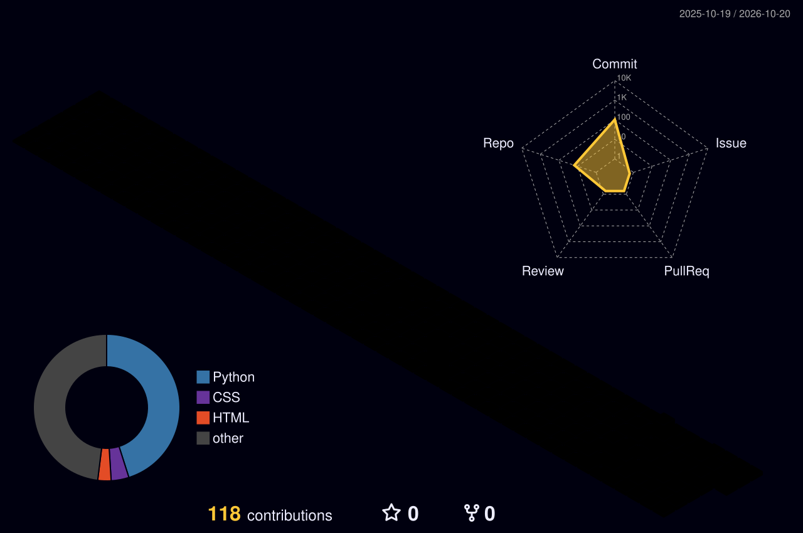
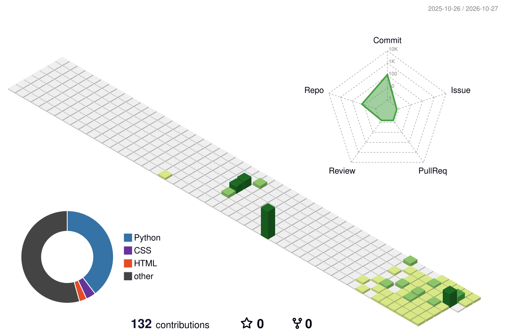
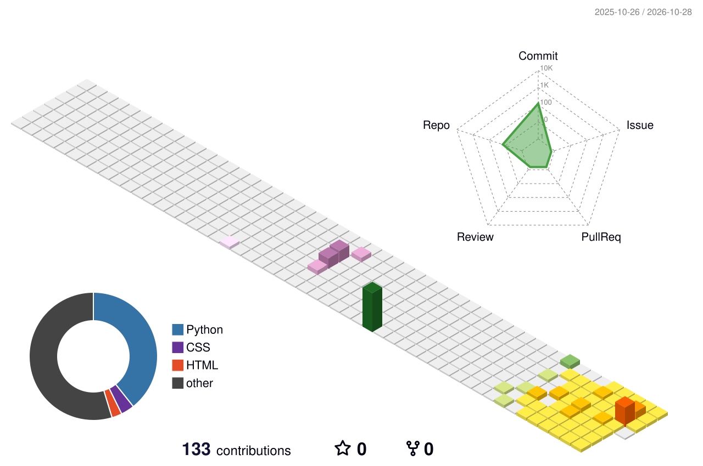

 

---

## 👨‍💻 About Me

Hi, I'm **Ayush Raj**, a Computer Science undergraduate interested in building intelligent applications and practical engineering solutions.

- 🎓 B.Tech Computer Science — Class of 2029
- 🌐 Google Student Ambassador
- 🤖 Interested in AI, Machine Learning and Computer Vision.
- ⚙️ Exploring IoT, backend development and full-stack technologies.
- 🚀 Interested in hackathons, problem-solving and collaborative projects.

---

## 🛠️ Tech Stack

**Programming Languages**

**AI, Computer Vision & Web Development**

**Tools & Platforms**

---

## 🚀 Featured Projects

<table width="100%">
<tr>
<td width="50%" valign="top">

### 💧 AquaIQ — Smart Irrigation

An intelligent irrigation system combining sensor readings with machine learning to support automated watering decisions.

**Tech:** ESP32, Random Forest, MQTT

</td>
<td width="50%" valign="top">

### 🏥 Ayushman AI

An AI-assisted healthcare and emergency response concept focused on triage, location-aware routing and multilingual accessibility.

**Tech:** LLMs, PostGIS, voice interfaces

</td>
</tr>
<tr>
<td width="50%" valign="top">

### 🪐 ExoHunter AI

A machine learning pipeline for analyzing astronomical light curves and identifying possible exoplanet transits.

**Tech:** Python, signal processing, ML

</td>
<td width="50%" valign="top">

### 🛡️ AI Media & Deepfake Forensics

A computer vision project focused on detecting AI-generated or manipulated media.

**Tech:** Python, computer vision, image analysis

</td>
</tr>
</table>

---

## 🌐 3D Contribution Graph

<b>⚡ More 3D Contribution Animations</b>

---

## 📊 GitHub Statistics

 

 

---

## 🤝 Connect With Me

  

**Building today. Innovating tomorrow.**

