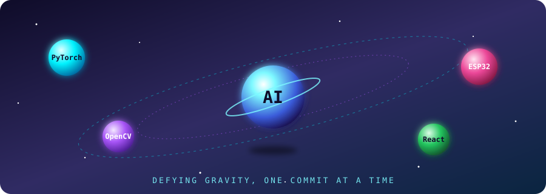
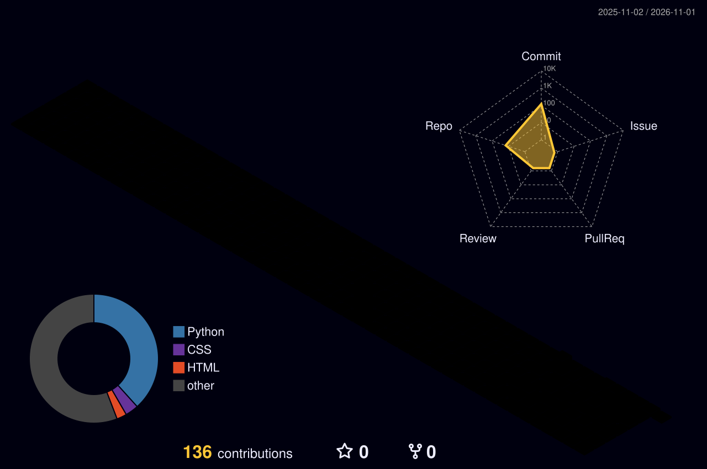
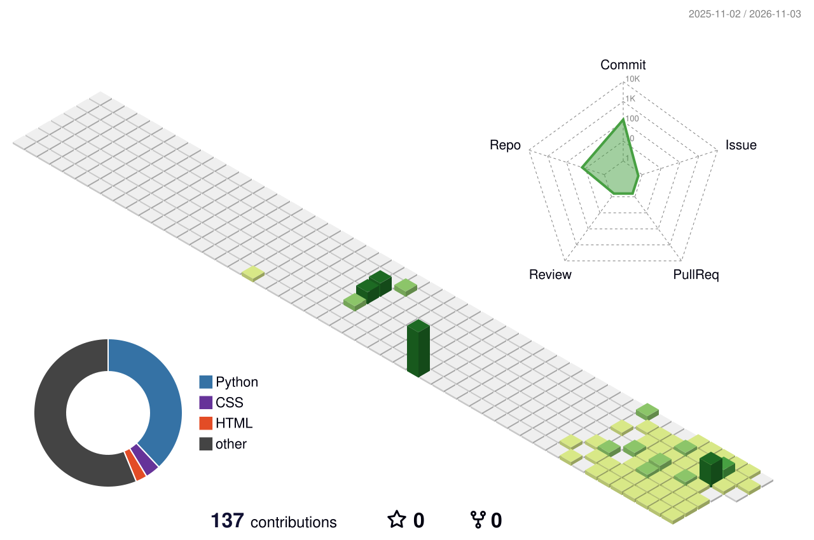
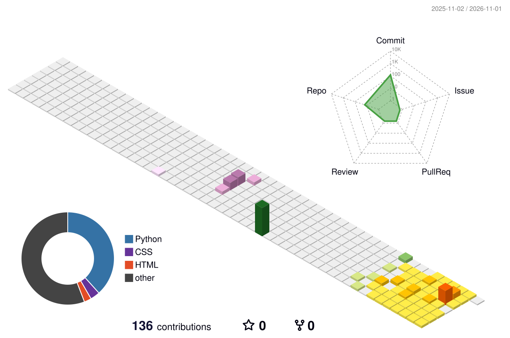

  

 

---

## 👨‍💻 About Me

Hi, I'm **Ayush Raj**, a Computer Science undergraduate who builds intelligent systems that connect software with the physical world

| | |
|---|---|
| 🎓 **Education** | B.Tech Computer Science, Class of 2029 |
| 🌐 **Community** | Google Student Ambassador |
| 🤖 **Focus** | AI, Machine Learning, Computer Vision |
| ⚙️ **Exploring** | IoT, backend systems, full-stack development |
| 🚀 **Also into** | Hackathons, problem-solving, collaborative projects |

---

## 🛠️ Tech Stack

**Languages**

**AI, Computer Vision & Web**

**Tools & Platforms**

---

## 🚀 Featured Projects

<table width="100%">
<tr>
<td width="50%" valign="top">

### 💧 AquaIQ — Smart Irrigation

Real-time IoT irrigation that combines live sensor data with machine learning to automate watering decisions.

`ESP32` `Random Forest` `MQTT`

</td>
<td width="50%" valign="top">

### 🏥 Ayushman AI

AI-assisted healthcare and emergency response: triage, location-aware routing and multilingual accessibility.

`LLMs` `PostGIS` `Voice`

</td>
</tr>
<tr>
<td width="50%" valign="top">

### 🪐 ExoHunter AI

ML pipeline that analyzes astronomical light curves to flag possible exoplanet transits.

`Python` `Signal Processing` `ML`

</td>
<td width="50%" valign="top">

### 🛡️ AI Media & Deepfake Forensics

Computer vision project for detecting AI-generated or manipulated media.

`Python` `Computer Vision` `Image Analysis`

</td>
</tr>
</table>

---

## 🌐 3D Contribution Graph

<b>⚡ More 3D animations</b>

---

## 🐍 Contribution Snake

<picture>
  <source media="(prefers-color-scheme: dark)" srcset="https://raw.githubusercontent.com/ayushraj623/ayushraj623/output/github-snake-dark.svg"/>
  <source media="(prefers-color-scheme: light)" srcset="https://raw.githubusercontent.com/ayushraj623/ayushraj623/output/github-snake.svg"/>
  
</picture>

---

## 📊 GitHub Statistics

 

---

## 🤝 Connect With Me

  

**Building today. Innovating tomorrow.**

